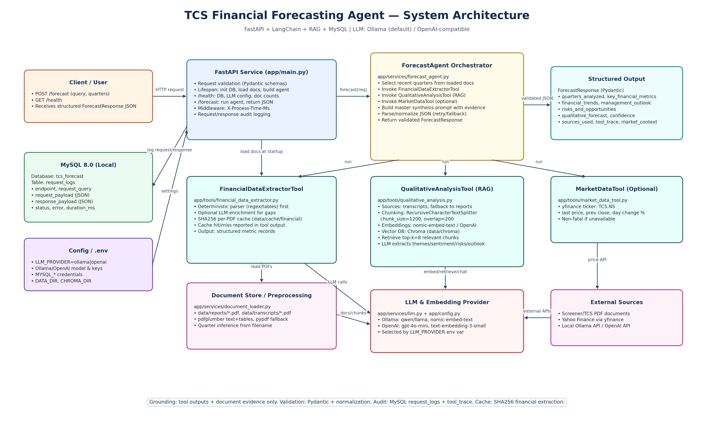

# TCS Financial Forecasting Agent

A FastAPI + LangChain agent that analyzes TCS quarterly financial reports (and transcripts, if available) to generate a **grounded, structured qualitative forecast** for the next quarter. It stores every `/forecast` request/response in MySQL for auditability.

## What this project does

- Loads TCS PDF documents from `data/reports` and `data/transcripts`
- Extracts key financial metrics with a **deterministic parser + optional LLM enrichment + cache**
- Runs **RAG-based qualitative analysis** over transcripts (or report fallback)
- Optionally adds live market context from `yfinance` (`TCS.NS`)
- Synthesizes a strict JSON forecast using a master prompt
- Logs request/response, status, and duration in MySQL

## Architecture



**Main flow:** Client → FastAPI (`/health`, `/forecast`) → ForecastAgent → tools (financial extraction, qualitative RAG, optional market data) → LLM synthesis → validated JSON response + MySQL `request_logs`.

## Project structure

```text
tcs-financial-forecast-agent/
  app/
    main.py                     # FastAPI app, endpoints, request logging
    config.py                   # env/config settings
    db/
      database.py               # MySQL engine/session/init
      models.py                 # RequestLog ORM model
    models/
      schemas.py                # Pydantic request/response schemas
    services/
      document_loader.py        # PDF loading + quarter inference
      financial_parser.py        # deterministic metric extraction
      financial_cache.py        # SHA256-based extraction cache
      forecast_agent.py         # orchestration + synthesis prompt
      json_utils.py             # loose JSON parsing helpers
      llm.py                    # Ollama/OpenAI model factory
    tools/
      financial_data_extractor.py
      qualitative_analysis.py
      market_data_tool.py
  data/
    reports/                    # place quarterly report PDFs here
    transcripts/                # place transcript PDFs here (optional)
    cache/                      # auto-created extraction cache (gitignored)
    chroma/                     # local vector DB (gitignored)
  docs/
    architecture.png
  scripts/
    smoke_test.py
  .env.example
  requirements.txt
  README.md
```

## Prerequisites

Install these before running:

- **Python 3.10+** (3.11 recommended)
- **MySQL 8.0+** running locally
- **Git**
- One LLM provider:
  - **Ollama (default, local/free)**: install Ollama and pull models, OR
  - **OpenAI-compatible API**: API key for OpenAI/Azure-compatible endpoint

## Quick start (GitHub → run locally)

### 1) Clone the repository

```bash
git clone https://github.com/ashutoshtiwari-web/TCS_Financial_Forecasting_Agent.git
cd TCS_Financial_Forecasting_Agent
```

### 2) Create and activate a virtual environment

```bash
python3 -m venv .venv
source .venv/bin/activate        # macOS/Linux
# .venv\Scripts\activate         # Windows PowerShell
```

### 3) Install dependencies

```bash
pip install --upgrade pip
pip install -r requirements.txt
```

### 4) Create your `.env` file

```bash
cp .env.example .env
```

Edit `.env` with your local values.

#### Option A: Ollama (default, local)

```env
LLM_PROVIDER=ollama
OLLAMA_BASE_URL=http://localhost:11434
OLLAMA_MODEL=qwen2.5:7b-instruct
OLLAMA_EMBED_MODEL=nomic-embed-text

MYSQL_HOST=localhost
MYSQL_PORT=3306
MYSQL_USER=root
MYSQL_PASSWORD=your_mysql_password
MYSQL_DATABASE=tcs_forecast

DATA_DIR=./data
CHROMA_DIR=./data/chroma
LOG_LEVEL=INFO
```

Make sure Ollama is running and models are pulled:

```bash
ollama pull qwen2.5:7b-instruct
ollama pull nomic-embed-text
ollama list
```

#### Option B: OpenAI (faster cloud inference)

```env
LLM_PROVIDER=openai
OPENAI_API_KEY=your_api_key_here
OPENAI_MODEL=gpt-4o-mini
OPENAI_BASE_URL=https://api.openai.com/v1

MYSQL_HOST=localhost
MYSQL_PORT=3306
MYSQL_USER=root
MYSQL_PASSWORD=your_mysql_password
MYSQL_DATABASE=tcs_forecast
```

> **Speed note:** Local Ollama on CPU can take several minutes per request. OpenAI is usually much faster (roughly ~20-90s depending on cache/warmth/model), because inference is remote and optimized.

### 5) Start MySQL and verify credentials

Make sure MySQL server is running. The app will auto-create the database/table on startup if the MySQL user has permission.

Optional manual DB creation:

```sql
CREATE DATABASE IF NOT EXISTS tcs_forecast CHARACTER SET utf8mb4 COLLATE utf8mb4_unicode_ci;
```

### 6) Add TCS documents

Place PDFs in:

- `data/reports/` — quarterly financial reports/results/factsheets
- `data/transcripts/` — earnings call transcripts (optional)

Use clear filenames with quarter labels, e.g. `TCS_Q1_FY2026-27_Financial_Results.pdf`.

If you need more documents, manually download them from [Screener TCS documents](https://www.screener.in/company/TCS/consolidated/#documents) and place PDFs in `data/reports/` or `data/transcripts/`.

### 7) Run the API locally

```bash
source .venv/bin/activate
PYTHONPATH=. uvicorn app.main:app --reload --host 127.0.0.1 --port 8000
```

Open API docs: [http://127.0.0.1:8000/docs](http://127.0.0.1:8000/docs)

### 8) Test the endpoints

#### Health check

```bash
curl http://127.0.0.1:8000/health
```

Expected shape:

```json
{
  "status": "ok",
  "database": "connected",
  "llm_configured": true,
  "documents_available": { "reports": 3, "transcripts": 0 }
}
```

#### Forecast request

```bash
curl -X POST http://127.0.0.1:8000/forecast \
  -H "Content-Type: application/json" \
  -d '{"query":"Analyze the financial reports for the last two quarters and provide a qualitative forecast for the upcoming quarter. Identify key financial trends, management outlook, and risks/opportunities.","quarters":2}'
```

## API

### `GET /health`
Returns service status, DB connectivity, LLM config status, and document counts.

### `POST /forecast`
Request body:

```json
{
  "query": "Your question here",
  "quarters": 2
}
```

Response includes: `company`, `generated_at`, `quarters_analyzed`, `key_financial_metrics`, `financial_trends`, `management_outlook`, `risks_and_opportunities`, `qualitative_forecast`, `confidence`, `sources_used`, `tool_trace`, `market_context`.

## MySQL logging

Every `/forecast` call is logged in `request_logs` (success or error) with:

- `endpoint`, `request_query`, `request_payload` (JSON)
- `response_payload` (JSON), `status`, `error_message`
- `duration_ms`, `created_at`

Quick check:

```sql
USE tcs_forecast;
SELECT id, status, duration_ms, LEFT(request_query, 60), created_at
FROM request_logs ORDER BY id DESC LIMIT 10;
```

## Caching & performance

- **Financial extraction cache**: `data/cache/financial/` stores per-PDF extraction results keyed by content SHA256. If a PDF changes, cache is invalidated automatically.
- **Chroma vector store**: persisted in `data/chroma/` for retrieval indexing.
- **First run is slower** due to extraction, embedding, and LLM synthesis; later runs benefit from cache/warm components.
- **Local Ollama**: works offline but can be slow on CPU. **OpenAI**: faster for demos/interviews.

## Final local test (recorded)

Local run with MySQL connected + Ollama (`qwen2.5:7b-instruct`) + cached financial extraction:

| Test | Result | Duration | Notes |
|---|---|---:|---|
| `/health` | Pass | <1s | DB connected, LLM configured, 3 reports detected |
| `/forecast` (validation normalization fix case) | Pass | ~169s | After adding schema normalization for missing trend `direction`; response logged as success in MySQL |
| MySQL `request_logs` | Pass | - | Success/error rows written with payloads and durations |

> Actual timing depends heavily on model/provider/hardware. OpenAI is recommended for faster interactive demos.

## Troubleshooting

- **`LLM not configured`**: check `.env` `LLM_PROVIDER`, API key (OpenAI), or Ollama URL/model.
- **Ollama slow/hangs**: local CPU inference is slow; use smaller context/questions, keep app warm, or switch to OpenAI.
- **MySQL connection error**: verify MySQL is running, credentials are correct, and password special chars are handled (app URL-encodes credentials).
- **No documents found**: place PDFs in `data/reports`/`data/transcripts` and restart app.
- **Bad/partial model JSON**: agent retries once and normalizes common schema drift; check `tool_trace` and `request_logs` for details.
- **Market data warning**: `yfinance` is optional; forecast still works without it.

## AI usage disclosure

- **LLM**: Ollama or OpenAI-compatible chat model via LangChain for extraction enrichment and final synthesis.
- **Embeddings**: `nomic-embed-text` (Ollama) or OpenAI embeddings for RAG.
- **RAG**: Recursive chunking + Chroma vector retrieval over transcripts/reports.
- **Guardrails**: grounded prompts, strict Pydantic schema, JSON parse retry/fallback, response normalization, tool trace, MySQL audit logs, non-fatal optional market tool.
- **Limits**: PDF layout variance, LLM hallucination/format drift, local-model latency, and qualitative (not deterministic financial modeling) output. Human review recommended before high-stakes use.
